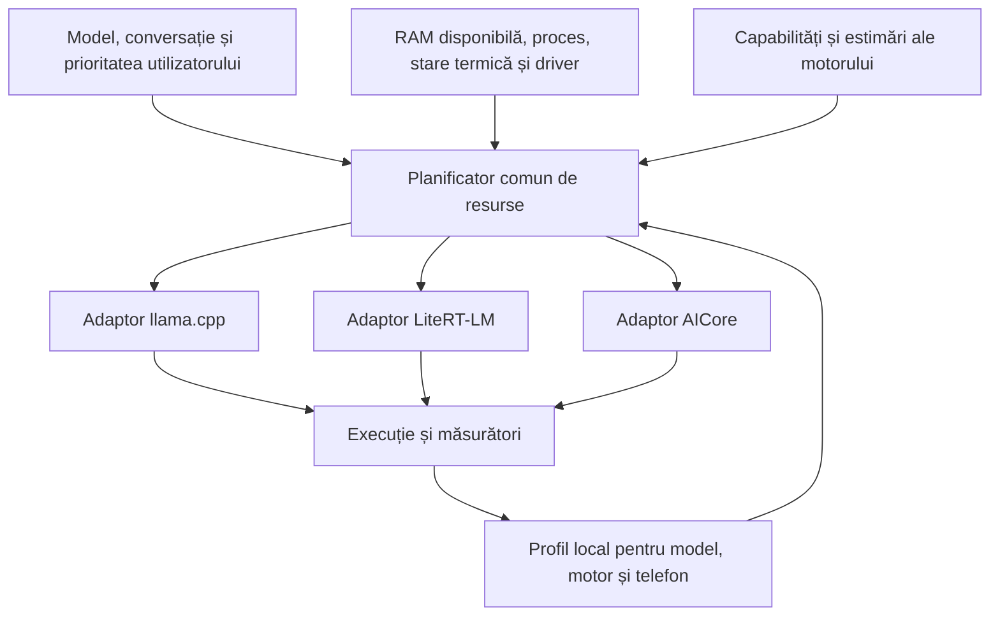

# Optimizarea tuturor motoarelor locale

Data analizei: 19 octombrie 2026.

## Obiectiv

Un gestionar comun alege pentru fiecare model compatibil distribuția calculelor, bugetul de memorie și contextul, folosind controalele reale ale motorului său. Acoperirea include toate modelele aplicației, cu adaptoare pentru llama.cpp, LiteRT-LM și AICore. Un motor nou va adăuga propriul adaptor și propriile capabilități.

Acest fișier descrie metoda de implementare. Gestionarul automat și offload-ul Vulkan pentru GGUF nu sunt încă implementate. Investigația a inclus codul local, API-urile SDK-urilor și diagnosticul Vulkan existent; nu a inclus benchmarkuri noi sau modificarea APK-ului.

## Ce putem controla efectiv

| Motor / versiune locală | Controale disponibile | Integrarea actuală / limită |
|---|---|---|
| PrismML/llama.cpp, `e3de715222b2667c54a267441159a5729f11155e` | Fire CPU, batch, context, straturi GPU, amplasare selectivă a tensorilor, amplasare și tip KV, offload al operațiilor | GGUF rulează acum pe CPU. Integrarea GPU necesită compilarea backendului Vulkan. Compatibilitatea depinde de arhitectură, cuantizare, operații și driver. |
| LiteRT-LM Android `0.18.0` | Backend principal CPU/GPU/NPU, `Backend.CPU(threadCount)`, backenduri separate pentru vision/audio, `maxNumTokens`, `maxNumImages`, tip activări compatibil | `EngineConfig` public nu expune număr de straturi GPU sau amplasare manuală KV. Distribuția internă aparține motorului/delegatului. Restricțiile modelului, de exemplu audio CPU pentru Gemma 3n, se păstrează. |
| AICore prin ML Kit Prompt `1.0.0-beta2` | Verificarea disponibilității, preferință FAST/FULL, warmup, limite de tokeni furnizate de serviciu și parametri de generare | AICore gestionează modelul, acceleratorul și memoria. Aplicația nu poate atribui manual straturi sau KV. Disponibilitatea pe acest telefon și pentru identificatorul forkului nu este stabilită de această analiză. |

Pentru LiteRT-LM a fost inspectată și clasa `EngineConfig` din AAR-ul local al versiunii 0.18.0 prin `javap`; lista de controale nu este dedusă din documentația versiunii `main`.

Compatibilitatea se verifică pe combinația **model + motor + backend**. Existența unui GPU/NPU nu dovedește că un model poate rula pe el. Schimbarea motorului poate necesita alt format de model și nu transferă automat cache-ul conversației.

## Relația dintre procesoare și memorie

CPU/GPU/NPU execută calcule; RAM-ul păstrează ponderi, KV, stări recurente și buffere temporare. Pe telefonul investigat CPU și GPU împart RAM-ul fizic, confirmat de diagnosticul driverului Android descris în [HYBRID_RUNTIME.md](HYBRID_RUNTIME.md).

| Resursă | Rol în plan |
|---|---|
| RAM accesibilă CPU și GPU | Buget comun pentru datele active; se urmăresc și eventualele copii ale acelorași date. |
| Cache L1/L2/L3 CPU, cache GPU și memorie locală de shader | Gestionate prin hardware și kerneluri optimizate. Nu sunt un heap general în care aplicația poate muta întregul KV. |
| Stocare internă, fișier mapat `mmap` | Ponderi recitibile și fișiere persistente. Paginile active ocupă RAM; accesul repetat la stocare poate limita viteza. |
| Swap / RAM extinsă oferită de sistem | Nu este adăugată la bugetul de RAM rapidă pentru inferență. |

Memoria unificată poate reduce copiile dacă motorul și driverul o folosesc astfel. Alocările CPU/GPU distincte pot totuși dubla temporar datele. Driverul acestui telefon nu oferă `VK_EXT_external_memory_host` sau `VK_EXT_memory_budget`; planul nu presupune import direct al oricărui pointer `mmap` sau un buget Vulkan dinamic.

## Arhitectura propusă



Componente propuse sub `runtime/optimization/`:

| Componentă | Contract |
|---|---|
| Profilul dispozitivului | Citește RAM disponibilă, `lowMemory`, pragul sistemului, PSS propriu și starea termică. Identifică driverul și backendurile utilizabile. |
| Adaptorul de optimizare al motorului | Declară controalele acceptate, estimarea memoriei, limitele modelului și dacă schimbarea configurației cere reinițializare. Aplică numai opțiuni acceptate. |
| Planificatorul | Produce configurații candidate care respectă memoria și limitele de context, apoi alege conform priorității și măsurătorilor existente. |
| Registrul de resurse | Coordonează încărcarea/descărcarea și bugetul tuturor instanțelor rezidente, inclusiv encodere și eventuale modele auxiliare. |
| Magazinul de profile | Salvează local configurația, proveniența estimărilor, măsurătorile și erorile recuperabile. |

Datele necunoscute rămân marcate ca necunoscute; un motor opac nu raportează artificial zero octeți pentru KV sau zero cost GPU. Profilul solicitat și backendul efectiv sunt raportate separat când motorul permite confirmarea.

Punctele de integrare sunt `LlmModelHelper` și cele trei implementări existente. `ModelManagerViewModel.initializeModel` și sesiunile folosesc același plan, astfel încât chatul, Prompt Lab și agenții nu dezvoltă politici diferite. Toate căile de inițializare, inclusiv cele ale sarcinilor personalizate, trebuie să treacă prin gestionarul comun.

Există deja `common/metrics/MemoryMonitor` pentru PSS și un tracker LiteRT-LM pentru tokeni/timpi. Aceste componente se reutilizează; adaptorul GGUF trebuie să expună măsurători native echivalente. PSS-ul procesului aplicației nu este tratat drept măsurătoare completă a memoriei GPU sau a serviciului AICore.

## Buget de memorie și context

Pentru fiecare configurație candidată estimăm separat:

```text
memorie rezidentă = ponderi active + KV + stare recurentă
                 + buffere de calcul + encodere/alte modele + costul runtime-ului

vârf la încărcare = date deja rezidente + alocări noi + copii temporare
```

Fiecare valoare păstrează sursa: raportată de motor, măsurată pe dispozitiv, estimată din metadate sau necunoscută. Mărimea fișierului descărcat nu înlocuiește consumul de inferență.

Bugetul pentru **alocări suplimentare** pornește de la `ActivityManager.MemoryInfo.availMem`, cu rezervă pentru sistem, UI și variații. `threshold` și `lowMemory` sunt semnale de presiune; nu garantează că orice alocare sub acel prag este sigură. La o replanificare cu modelul deja încărcat, estimăm diferența și eventualul vârf de înlocuire, fără să scădem încă o dată toate alocările existente din `availMem`.

Pentru atenție standard, o aproximare KV este suma pe straturi a:

```text
tokeni păstrați × număr capete KV × dimensiune cap × (octeți K + octeți V)
```

Se adaugă aliniere, metadate și secvențe concurente. Atenția cu fereastră locală, cache-urile cuantizate și arhitecturile recurente cer estimatori proprii. De exemplu, Bonsai 27B Qwen3.5 are atât KV, cât și stare recurentă; nu aplicăm formula de atenție standard tuturor straturilor sale.

Contextul ales respectă simultan:

1. Limita acceptată de arhitectura/configurația modelului și contextul pentru care există dovezi de calitate.
2. Limita motorului/backendului și eventualele forme fixe ale modelului exportat.
3. Bugetul estimat de memorie, inclusiv bufferele care cresc cu contextul.
4. Spațiul pentru promptul formatat, istoric, instrumente, imagini/audio și răspuns, inclusiv tokenii Thinking.

Pentru motoarele cu fereastră comună, inputul plus outputul trebuie să încapă în context. Pentru servicii cu limite separate, adaptorul păstrează semantica lor. LiteRT-LM documentează `maxNumTokens` ca total input + output; AICore este interogat pentru limita sa și nu primește o limită inventată din RAM-ul telefonului.

Un context mai mare acceptat de motor nu dovedește automat aceeași calitate. Rezumarea/RAG pot păstra informații utile dintr-un istoric mai lung, dar se prezintă separat de contextul activ real.

## Alegerea configurației

| Profil | Prioritate |
|---|---|
| Automat / echilibrat | Contextul cerut, cu timp bun de răspuns și memorie disponibilă suficientă. |
| Viteză | Timp până la primul token și viteză susținută, pentru contextul cerut. |
| Context maxim | Cea mai mare fereastră fezabilă și acceptată, cu posibil cost de viteză. |
| Calitate | Păstrează preciziile și opțiunile validate pentru model; comprimarea KV sau alte reduceri de precizie sunt opțiuni distincte. |

Distribuția hardware poate schimba viteza și consumul. Calitatea depinde și de model, cuantizare, precizia calculelor și context; mutarea pe GPU nu o mărește automat. Nu există o singură configurație care maximizează garantat toate aceste obiective.

Algoritmul propus:

1. Identifică exact modelul și citește capabilitățile adaptorului; elimină combinațiile incompatibile.
2. Citește presiunea de memorie și starea termică. Refolosește un profil compatibil sau generează candidați conservatori din metadate.
3. Elimină candidații care depășesc limitele. Pentru memorie opacă folosește o politică conservatoare și limitele serviciului; nu pretinde o alocare controlată de aplicație.
4. Alege cel mai bun profil **măsurat** pentru prioritatea curentă; fără măsurători, îl etichetează ca estimat. Un candidat neîncercat nu devine automat „optim”.
5. Inițializează motorul și confirmă backendul și contextul efective unde sunt expuse. Erorile recuperabile permit o configurație compatibilă mai modestă, afișând configurația efectiv folosită.
6. Înregistrează timpii și memoria la utilizarea normală. Comparațiile controlate folosesc aceeași sarcină, aceleași lungimi și aceeași configurație a modelului, separând rulările reci/calde și condițiile termice.
7. Replanifică între răspunsuri când se schimbă condițiile. Dacă schimbarea cere reîncărcare, finalizează/anulează operația, eliberează resursele vechi și recreează conversația din istoric.

Nu migrăm transparent o stare KV arbitrară între motoare sau backenduri incompatibile. Istoricul conversației se păstrează separat de starea nativă. O eroare de alocare recuperabilă poate avea fallback; o terminare a procesului de Android nu poate fi prinsă ca excepție obișnuită și nu trebuie folosită ca metodă de calibrare.

Cheia profilului include identitatea/conținutul modelului, cuantizarea, versiunea motorului, dispozitivul/driverul, backendul, contextul, modalitățile, precizia cache-ului și versiunea politicii. Schimbarea driverului sau motorului invalidează recomandările care depindeau de ele. Alegerea altui model ori a altei cuantizări necesită selecție explicită.

## Reducerea calculelor repetate

În `gguf_engine.cpp`, fiecare generare apelează acum `llama_memory_clear` și reprocesează întregul prompt formatat. Reutilizarea prefixului/KV poate reduce timpul până la primul token pe turele următoare, independent de adăugarea GPU.

Optimizarea păstrează tokenii prefixului și starea nativă numai dacă se potrivesc exact cu promptul nou. Schimbarea instrucțiunii de sistem, template-ului, Thinking, istoricului sau modelului cere verificarea prefixului. Pentru modele recurente, rollback-ul cere suport real al motorului/snapshoturi; fără el se reconstruiește starea. Anularea, eșecul și ultimul token generat încă nedecodat se tratează explicit.

LiteRT-LM păstrează deja o conversație nativă; se evită resetările inutile. Pentru AICore se folosesc numai mecanismele publice disponibile, fără a presupune existența unui KV accesibil aplicației. `cacheDir` LiteRT-LM pentru fișiere de cache nu este o comandă de mutare a KV pe stocare.

## Ordinea integrării

1. Gestionar comun, capabilități per motor, buget de memorie, profile persistente și raportarea configurației efective.
2. GGUF: compilare locală Vulkan, selecție de straturi/tensori și amplasare KV; detaliile sunt în [HYBRID_RUNTIME.md](HYBRID_RUNTIME.md). Reutilizarea cache-ului se implementează cu reguli separate pentru atenție și modele recurente.
3. LiteRT-LM: aplicarea planului la backendul compatibil, fire CPU, context și encodere; fără opțiuni de amplasare pe care SDK-ul 0.18.0 nu le expune.
4. AICore: integrarea disponibilității, limitei reale, preferinței modelului și warmup-ului în același gestionar.
5. Compararea profilelor pe telefon și folosirea măsurătorilor pentru recomandări. Viteza maximă sau un context numeric maxim se raportează numai după măsurarea configurației exacte.

Dezvoltarea și compilarea rămân locale pe telefon. Livrările înlocuiesc același `Download/Local-Edge-Gallery-Bonsai.apk`, conform `AGENTS.md`.

## Surse primare și dovezi locale

- [API PrismML/llama.cpp la commitul fixat](https://github.com/PrismML-Eng/llama.cpp/blob/e3de715222b2667c54a267441159a5729f11155e/include/llama.h)
- [Configurația publică LiteRT-LM v0.18.0](https://github.com/google-ai-edge/LiteRT-LM/blob/v0.18.0/kotlin/java/com/google/ai/edge/litertlm/Config.kt)
- [ML Kit Prompt: selecția modelului AICore](https://developers.google.com/ml-kit/genai/prompt/android/select-model)
- [Android: RAM disponibilă și praguri de presiune](https://developer.android.com/reference/android/app/ActivityManager.MemoryInfo)
- [Android: starea termică prin PowerManager](https://developer.android.com/reference/android/os/PowerManager#getCurrentThermalStatus())
- [Khronos: alocări și memorie unificată](https://docs.vulkan.org/guide/latest/memory_allocation.html)
- Cod local: `runtime/ModelHelperExt.kt`, `runtime/LlmModelHelper.kt`, adaptoarele existente, `data/BackendSpec.kt`, `gguf_engine.cpp`, `common/metrics/MemoryMonitor.kt` și trackerul LiteRT-LM.
- Diagnostic existent al driverului de sistem: `.local-build/android-vulkan-memory.json`; acesta enumeră capabilități, fără să dovedească performanța inferenței hibride.
